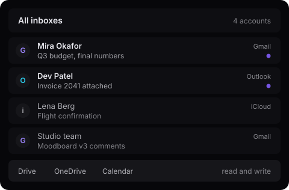
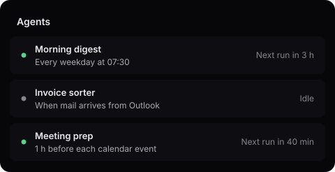
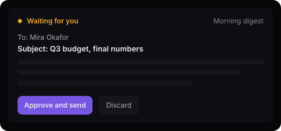
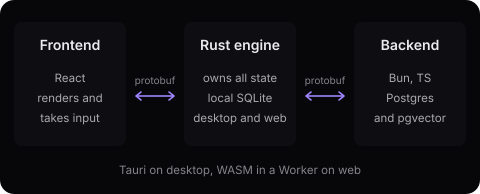

<div align="center">

<picture>
  <source media="(prefers-color-scheme: dark)" srcset="docs/readme/logo-dark.svg"/>
  
</picture>

**The mail client for every inbox, with agents you control**

Early: the architecture and a walking skeleton are in place, the features are not.

<a href="https://github.com/xuckless/everymail/actions/workflows/ci.yml"></a> <a href="#license"></a>

[Architecture rules](AGENTS.md) · [License](#license)

</div>

## What it will do

EveryMail is being built as one client for all your mail, Drive, OneDrive and calendar. Agents you define handle routine work on a schedule, and nothing they draft leaves without your approval. The pictures below are sketches of the planned interface, not screenshots.

## Every inbox in one list

Gmail, Outlook, iCloud and others sit side by side. Drive, OneDrive and calendar are readable and writable from the same place.



## Agents that run on a schedule

You write an agent profile and a trigger. The agent runs the task on its own, at a time or when mail arrives.



## Nothing sends without approval

An agent's reply waits as a draft. You read it, then approve and send, or discard it.



## How it is built

The Rust engine sits between the UI and the server. The UI talks only to the engine, and the engine is the only client of the Backend.



- The engine owns all application state and sends it as protobuf `oneof`s. TypeScript holds only presentation state.
- Protobuf is the only wire format.
- One Rust crate serves desktop (native in Tauri) and web (WASM in a Worker).
- The Frontend never talks to the Backend.

Target: the whole desktop app under 300-400 MB of RAM.

## Develop

Needs [Bun](https://bun.sh), Rust with the `wasm32-unknown-unknown` target, [wasm-pack](https://rustwasm.github.io/wasm-pack/), Docker for the dev Postgres, and [Tauri's system dependencies](https://v2.tauri.app/start/prerequisites/) on Linux.

```sh
bun install
bun run gen            # TypeScript from the .proto files
bun run wasm           # the engine as a WASM package
docker compose up -d   # dev Postgres with pgvector
bun run dev:backend
bun run dev:desktop    # Tauri app
bun run dev:web        # same UI, engine as WASM in a Worker
bun run check          # lint, types, clippy, tests
```

- `proto/` the contract
- `backend/` Bun and Postgres
- `engine/` the Rust crate
- `desktop/` the Tauri shell
- `frontend/` the React UI

Rules are in [AGENTS.md](AGENTS.md). The roadmap is in [TODO-backend.md](TODO-backend.md), [TODO-rust-core.md](TODO-rust-core.md) and [TODO-frontend.md](TODO-frontend.md).

## License

[FSL-1.1-ALv2](LICENCE.md). Use, modify and self-host it for any purpose except a competing product. Each release becomes Apache-2.0 two years after it ships.
